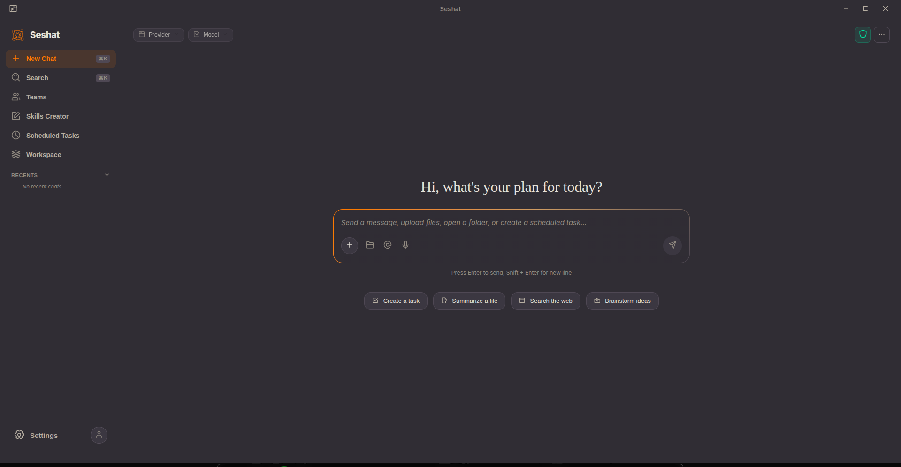
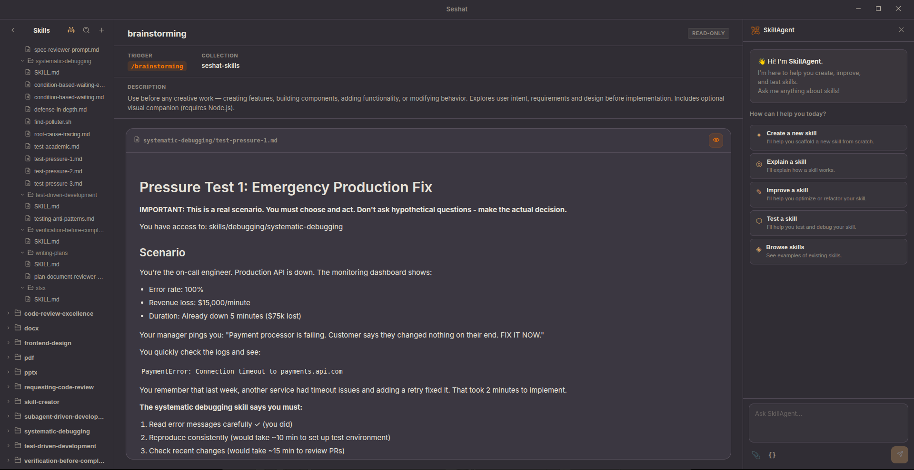
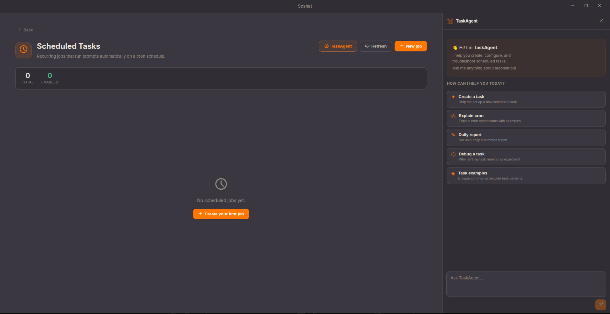
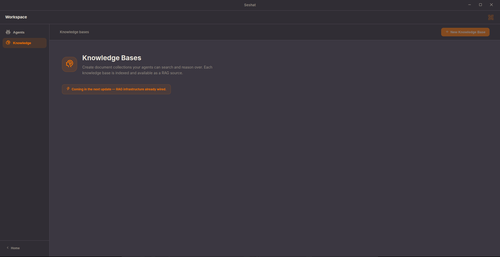

<p align="center">
  
</p>

<h1 align="center">SeshatOS</h1>

<p align="center">
  <b>SeshatOS (seshat-ai) is a self-hosted, multi-user agent platform for real organizations.</b><br>
  <i>Built on seshat &nbsp;·&nbsp; REST API + desktop app &nbsp;·&nbsp; governance, workspaces, knowledge, scheduling &nbsp;·&nbsp; AGPL-3.0</i>
</p>

<p align="center">
  
  
  
  
  
</p>

<p align="center">
  <a href="https://seshat-ai.com"><b>🌐 seshat-ai.com</b></a> ·
  <a href="https://github.com/KPO-Tech/seshat"><b>⚙️ seshat (engine)</b></a> ·
  <a href="https://github.com/KPO-Tech/seshat/discussions"><b>💬 Discussions</b></a>
</p>

---

## What SeshatOS Is Today

SeshatOS is the platform layer built on top of [seshat](https://github.com/KPO-Tech/seshat), the open-source Go runtime.

Its current wedge is not "AI for everything." It is much narrower and more useful:

- self-hosted, multi-user agent infrastructure
- users, organizations, workspaces, API keys, quotas, and auditability
- REST + SSE access to the runtime for products, internal tools, and operators
- governed execution with permissions, knowledge, memories, skills, and MCP management
- scheduled tasks and deployment-friendly control around a real runtime core

In other words: SeshatOS is for teams that want agent capability inside a real environment, under clear operational boundaries.

## Why This Exists

Most AI products are still optimized for individual assistance. Organizations usually need something else:

- deployment inside their own environment
- provider portability instead of one-vendor dependence
- workspace and user boundaries
- auditable behavior around tool execution
- knowledge and workflow layers around the runtime

SeshatOS exists to provide that platform layer without hiding the engine underneath.

## Broad Vision, Narrow Product Wedge

The project still keeps a larger open-source direction: organized agent teams, richer workflow coordination, deeper automation, and more specialized surfaces over time.

But the current product message should stay disciplined. Today, the strongest claim is that SeshatOS is a governed, self-hosted agent platform for real organizations. The larger vision matters for contributors and long-term partners; the narrower wedge is what makes the platform credible now.

- Engine repository: https://github.com/KPO-Tech/seshat
- Public docs: https://seshat-ai.com/docs
- Vision and direction: https://seshat-ai.com/docs/learn/vision

## Architecture At A Glance

The **`seshat-ai`** repository contains **SeshatOS**, a self-hosted AI workspace for teams built as a desktop app plus a full REST API. It sits on top of **[seshat](https://github.com/KPO-Tech/seshat)**, the open-source Go runtime for multi-turn AI agents with tools, permissions, sessions, RAG, and MCP.

```
┌─────────────────────────────────┐
│  seshat-ui  (Electron + React)  │  Desktop app — always talks to seshat-backend only
└────────────┬────────────────────┘
             │ HTTP + SSE (127.0.0.1)
┌────────────▼────────────────────┐
│  seshat-backend/cmd/api         │  Local REST API — auth, memory, plans, skills, RAG
│  seshat-backend/internal/*      │  standalone (default) or connected (optional, below)
└────────────┬────────────────────┘
             │ Go SDK (pkg/sdk), used directly in both modes
┌────────────▼────────────────────┐
│  seshat  (external Go module)   │  Agent runtime, tools, providers, MCP
└─────────────────────────────────┘

  ── optional "connected" mode (reachability-probed at boot, not user-configurable) ──

┌─────────────────────────────────┐      ┌──────────────────────────────┐
│  seshat-server/cmd/server       │◄─────┤  seshat-console (React)      │
│  Cloud identity/org/automation/ │ HTTP │  Web control plane — platform│
│  knowledge/quotas control plane │      │  & organization admins       │
└─────────────────────────────────┘      └──────────────────────────────┘
```

Dependency direction is strictly one-way: `seshat-ai` imports `seshat/pkg/*` only, never the reverse. `seshat-ui` never talks to `seshat-server` directly — only through `seshat-backend` as the single gateway. In **standalone mode** (the default), `seshat-backend` runs fully offline with its own local auth/org/RBAC; in **connected mode**, identity, provider settings, preferences, skills/web-search/MCP registries, memories, agent presets, and usage counters are instead resolved from `seshat-server`, per-domain — see [`ROADMAP.md`](ROADMAP.md) for the current migration status.

Which mode a given build runs in is **not a user or operator setting**. `seshat-server` access is Seshat's paid managed-service tier, so `seshat-backend` decides at boot, on its own, whether to use it — by probing a single URL compiled into the binary (`defaultServerURL` in `seshat-backend/internal/config/bootstrap.go`) and falling back to standalone mode if it isn't reachable. There is deliberately no environment variable or config field that retargets this.

---

## 🖥️ Desktop UI


SeshatOS ships with `seshat-ui`, an Electron + React desktop application that wraps the full HTTP API.

<table>
  <tr>
    <td align="center" width="50%">
      
      <br><sub><b>Home</b> — new chat, quick actions, provider &amp; model selector</sub>
    </td>
    <td align="center" width="50%">
      
      <br><sub><b>Skills Creator</b> — author reusable agent skills with live preview and test chat</sub>
    </td>
  </tr>
  <tr>
    <td align="center" width="50%">
      
      <br><sub><b>Scheduled Tasks</b> — recurring agent jobs on a cron schedule, with built-in TaskAgent</sub>
    </td>
    <td align="center" width="50%">
      
      <br><sub><b>Workspace</b> — agents, knowledge bases and document collections</sub>
    </td>
  </tr>
</table>

---

## ✨ Features

- 🔐 **Multi-user auth** - email/password, API keys, roles, organizations, workspaces
- 📡 **Streaming chat** - SSE-based streaming with per-turn tool events and permission prompts
- 💬 **Session management** - persistent sessions with ownership and workspace isolation
- 🧠 **Memory** - user-defined memories injected into every session context
- 📋 **Plans** - structured multi-step plans attached to sessions with status lifecycle
- ⚡ **Skills** - slash-command shortcuts that resolve to prompt expansions, skill repository browser
- 📚 **Knowledge / RAG** - hybrid BM25 + vector search over document corpora, multi-backend
- 📄 **Document conversion** - optional Docling integration (PDF/DOCX/PPTX/XLSX/audio/images → markdown before ingestion), auto-managed locally or self-hosted
- 🔌 **MCP servers** - per-user MCP server config stored in DB, resolved at runtime, hot-reload
- ⏰ **Scheduled tasks** - cron-based background agent runs with job history
- 🌐 **Web search** - pluggable backends (Tavily, Exa, Jina, SearXNG, auto-select)
- 📎 **File attachments** - images and documents injected as context
- 📊 **Audit log** - append-only log of all queries and admin actions
- 📈 **Quotas** - per-user usage counters (daily / monthly)
- 🤖 **Anthropic compat** - drop-in `/v1/messages` endpoint for any Anthropic SDK client
- 📉 **Observability** - Prometheus `/metrics`, structured log output
- 🌍 **Multi-provider** - Anthropic, OpenAI, Codex (ChatGPT Pro OAuth), Mistral, Google Gemini, Z.ai, MiniMax, OpenRouter, Ollama
- 🔄 **Auto-update** - the desktop app checks, downloads, and installs updates in the background (never mid-session, always user-confirmed)
- ☁️ **Optional cloud mode** - connect to a `seshat-server` deployment for centrally-managed identity, provider settings, and org policy, administered via `seshat-console`

---

## 📊 How SeshatOS Compares

| Feature | **SeshatOS** | Claude Code | Open WebUI | LibreChat | AnythingLLM |
|---|:---:|:---:|:---:|:---:|:---:|
| Multi-user + RBAC | ✅ | ❌ | ✅ | ✅ | ✅ |
| Self-hosted | ✅ | ✅ | ✅ | ✅ | ✅ |
| Multi-provider | ✅ | ❌ | ✅ | ✅ | ✅ |
| Real agent execution | ✅ | ✅ | ❌ | ❌ | Partial |
| Permission-gated local tools | ✅ | ✅ | ❌ | ❌ | ❌ |
| MCP client | ✅ | ✅ | Partial | ❌ | ❌ |
| Skills system | ✅ | ✅ | ❌ | ❌ | ❌ |
| Knowledge base / RAG | ✅ | ❌ | ✅ | ✅ | ✅ |
| Scheduled tasks | ✅ | ❌ | ❌ | ❌ | ❌ |
| Desktop app | ✅ | ❌ | ❌ | ❌ | ✅ |
| REST API + SSE | ✅ | ❌ | ✅ | ✅ | Partial |
| Go binary (no deps) | ✅ | ❌ | ❌ | ❌ | ❌ |
| Audit log | ✅ | ❌ | ❌ | Partial | ❌ |
| Agent team runtime | 🔜 | ❌ | ❌ | ❌ | ❌ |
| Open-source license | AGPL-3.0 | ❌ | MIT | MIT | MIT |

---

## 🗂️ Repository Structure

```
seshat-ai/
├── seshat-backend/
│   ├── cmd/api/              ← thin local-backend entrypoint (main.go + config.go)
│   └── internal/             ← backend packages: api, db, auth, query, scheduler, ...
├── seshat-server/
│   ├── cmd/server/           ← cloud-server entrypoint
│   └── internal/server/      ← cloud domains: iam, automation, knowledge, memories, ...
├── seshat-console/           ← web admin frontend for seshat-server (React + TypeScript)
├── seshat-ui/                ← Electron desktop app (React + TypeScript)
├── deploy/                   ← docker-compose stack: postgres + seshat-server + seshat-console
└── docs/                     ← Architecture, development guide, UI docs
```

---

## 🚀 Quick Start

### Prerequisites

- Go 1.26+
- Node 22+ (for the desktop UI)

### Clone

```bash
git clone https://github.com/EngineerProjects/seshat-ai.git
cd seshat-ai
```

### Configure

```bash
cp .env.example .env
# Edit .env: set SESHAT_ADMIN_EMAIL, SESHAT_ADMIN_PASSWORD,
# and at least one provider key (ANTHROPIC_API_KEY, OPENAI_API_KEY, etc.)
```

### Run the backend

```bash
cd seshat-backend
go run ./cmd/api
# API available at http://localhost:8090
```

### Run the desktop UI

```bash
make ui-install     # install npm deps
make ui-dev         # Electron in dev mode
```

Or start everything at once:

```bash
make dev
```

### Install git hooks (recommended)

```bash
make hooks
```

### Optional: cloud control plane (`seshat-server` + `seshat-console`)

For centrally-managed identity, provider settings, and org policy across multiple `seshat-backend` instances:

```bash
cd deploy
cp .env.example .env   # set POSTGRES_PASSWORD and SESHAT_SERVER_ENCRYPTION_KEY
docker compose up --build
```

See [`deploy/README.md`](deploy/README.md). A `seshat-backend` build only switches into connected mode against a `seshat-server` deployment reachable at the URL compiled into that build (see the architecture diagram above) — there is no runtime variable to point an existing build at a different deployment.

---

## ⚙️ Configuration

All config is via environment variables. See [`.env.example`](.env.example) for the full reference.

| Variable | Default | Description |
|---|---|---|
| `PORT` | `8090` | HTTP listen port |
| `LOG_LEVEL` | `INFO` | `DEBUG` · `INFO` · `WARN` · `ERROR` |
| `SESHAT_DB_DRIVER` | `sqlite` | `sqlite` or `postgres` |
| `SESHAT_DB_DSN` | `seshat.db` | Database connection string |
| `SESHAT_ADMIN_EMAIL` | - | Bootstrap admin email (first run) |
| `SESHAT_ADMIN_PASSWORD` | - | Bootstrap admin password (first run) |
| `SESHAT_ENABLE_SIGNUP` | `true` | Allow user self-registration |
| `ANTHROPIC_API_KEY` | - | Anthropic provider |
| `OPENAI_API_KEY` | - | OpenAI provider |
| `MISTRAL_API_KEY` | - | Mistral provider |
| `WEB_SEARCH_PROVIDER` | `auto` | `tavily` · `exa` · `jina` · `searxng` · `auto` |
| `RAG_EMBEDDING_PROVIDER` | `ollama` | `ollama` or `openai` |
| `RAG_EMBEDDING_MODEL` | `nomic-embed-text` | Embedding model name |
| `SESHAT_DOCLING_URL` | *(auto)* | Docling-serve URL for binary-document conversion; empty/`auto` auto-manages a local instance, or point at a self-hosted one |

`seshat-server`/connected mode is intentionally **not** in this table: it is not environment-configurable (see architecture diagram above).

---

## 🌐 API

The server starts on port `8090` by default. All `/api/v1/*` routes require `Authorization: Bearer <token>` unless noted.

### Auth

```
POST   /api/v1/auth/login
POST   /api/v1/auth/register
POST   /api/v1/auth/logout
GET    /api/v1/auth/me
GET    /api/v1/auth/admin/ping       (admin only)
```

### Query

```
POST   /api/v1/query                 run a prompt (blocking JSON)
POST   /api/v1/query/stream          run a prompt (SSE streaming)
GET    /api/v1/permissions/:id       respond to a tool-permission request
GET    /api/v1/prompts/:id           respond to an interactive prompt request
```

### Sessions

```
GET    /api/v1/sessions
POST   /api/v1/sessions
GET    /api/v1/sessions/search
GET    /api/v1/sessions/:id
PATCH  /api/v1/sessions/:id
DELETE /api/v1/sessions/:id
```

### Agents

```
GET    /api/v1/agents
POST   /api/v1/agents
GET    /api/v1/agents/:slug
PUT    /api/v1/agents/:slug
DELETE /api/v1/agents/:slug
```

### Skills

```
GET    /api/v1/skills
POST   /api/v1/skills
PUT    /api/v1/skills/:name
DELETE /api/v1/skills/:name
GET    /api/v1/skills/:name/content
GET    /api/v1/skills/:name/tree
GET    /api/v1/skills/:name/file

GET    /api/v1/skills/repos          (admin only)
POST   /api/v1/skills/repos          (admin only)
DELETE /api/v1/skills/repos/:name    (admin only)
```

### Files

```
GET    /api/v1/files
POST   /api/v1/files
GET    /api/v1/files/:id/content
DELETE /api/v1/files/:id
```

### Knowledge (RAG)

```
GET    /api/v1/corpora
POST   /api/v1/corpora
GET    /api/v1/corpora/:id
DELETE /api/v1/corpora/:id
POST   /api/v1/corpora/:id/ingest
POST   /api/v1/corpora/:id/search
```

### Memories

```
GET    /api/v1/memories
POST   /api/v1/memories
DELETE /api/v1/memories
PUT    /api/v1/memories/:id
DELETE /api/v1/memories/:id
```

### Plans

```
GET    /api/v1/plans
GET    /api/v1/plans/:id
PATCH  /api/v1/plans/:id
```

### Scheduler

```
GET    /api/v1/scheduler/jobs
POST   /api/v1/scheduler/jobs
GET    /api/v1/scheduler/jobs/:id
PUT    /api/v1/scheduler/jobs/:id
DELETE /api/v1/scheduler/jobs/:id
POST   /api/v1/scheduler/jobs/:id/run
```

### MCP (admin only)

```
GET    /api/v1/mcp
GET    /api/v1/mcp/config
POST   /api/v1/mcp/config
GET    /api/v1/mcp/config/:id
PUT    /api/v1/mcp/config/:id
DELETE /api/v1/mcp/config/:id
POST   /api/v1/mcp/reload
```

### Settings (admin only)

```
GET    /api/v1/settings/providers
POST   /api/v1/settings/providers
PUT    /api/v1/settings/providers/:id
DELETE /api/v1/settings/providers/:id

GET    /api/v1/settings/embedder
PUT    /api/v1/settings/embedder

GET    /api/v1/settings/storage
PUT    /api/v1/settings/storage
```

### Web Search

```
POST   /api/v1/web/search
GET    /api/v1/web/search/settings
PUT    /api/v1/web/search/settings
GET    /api/v1/web/search/logs
GET    /api/v1/web/search/providers
POST   /api/v1/web/search/providers
GET    /api/v1/web/search/providers/:name
PUT    /api/v1/web/search/providers/:name
DELETE /api/v1/web/search/providers/:name
GET    /api/v1/web/search/domain-catalog
```

### Users

```
GET    /api/v1/users                 (admin)
POST   /api/v1/users                 (admin)
GET    /api/v1/users/me
GET    /api/v1/users/me/preferences
PUT    /api/v1/users/me/preferences
GET    /api/v1/users/me/api-keys
POST   /api/v1/users/me/api-keys
DELETE /api/v1/users/me/api-keys/:id
GET    /api/v1/users/:id
PATCH  /api/v1/users/:id
DELETE /api/v1/users/:id
```

### Groups, Organizations, Workspaces

```
GET|POST              /api/v1/groups
GET|PATCH|DELETE      /api/v1/groups/:id

GET|POST              /api/v1/organizations
GET|PATCH|DELETE      /api/v1/organizations/:id

GET|POST              /api/v1/workspaces
GET|PATCH|DELETE      /api/v1/workspaces/:id
```

### System

```
GET    /api/v1/models                list available models per provider
GET    /api/v1/quotas                usage counters for the current user
GET    /api/v1/audit/logs
POST   /api/v1/desktop/handshake     Electron desktop auth handshake
GET    /health
GET    /metrics                      Prometheus scrape endpoint
```

### Anthropic-compatible endpoint

```
POST   /v1/messages
```

Set `ANTHROPIC_BASE_URL=http://<host>/v1` in any Anthropic SDK client to route through SeshatOS.
Auth: `x-api-key: <seshat-api-key>` or `Authorization: Bearer <seshat-jwt>`.

---

## 🛠️ Development

```bash
make test           # go test ./...
make test-race      # go test -race ./...
make vet            # go vet ./...
make lint           # golangci-lint
make fmt            # gofmt -w .
make tidy           # go mod tidy
```

Full development guide: [`docs/development.md`](docs/development.md)  
Architecture overview: [`docs/architecture.md`](docs/architecture.md)

---

## 🧩 Adding a New Domain

**1. Service** - `internal/<domain>/service.go`

```go
package <domain>

type Service struct{ store *db.XxxStore }

func NewService(store *db.XxxStore) *Service { ... }
func (s *Service) List(ctx context.Context, p auth.Principal) ([]Thing, error) { ... }
```

**2. Wire** - `internal/app.go`

```go
// Dependencies
XxxStore *db.XxxStore

// App
Xxx *<domain>.Service

// NewApp
Xxx: <domain>.NewService(deps.XxxStore),
```

**3. Handler** - `internal/api/<domain>.go`

```go
func (app *App) handleThings(w http.ResponseWriter, r *http.Request) {
    principal, _ := authPrincipalFromContext(r.Context())
    things, err := app.backend.Xxx.List(r.Context(), principal)
    writeJSON(w, http.StatusOK, things)
}
```

**4. Route** - `internal/api/routes.go`

```go
apiV1.Handle("/things", app.authMiddleware(http.HandlerFunc(app.handleThings)))
```

---

## 🤝 Contributing

See [`CONTRIBUTING.md`](CONTRIBUTING.md). PRs target `dev`, never directly `main`.

---

## 📄 License

> **Draft status:** the split below is not yet in effect for any published version — see the notice at the top of [`LICENSE`](LICENSE) and [`ROADMAP.md`](ROADMAP.md). Today the whole repository is AGPL-3.0.

This repository is moving toward a directory-split license, the same pattern used by GitLab and OpenWork:

- `seshat-backend/` and `seshat-ui/` — **GNU Affero General Public License v3.0** (AGPL-3.0), see [`LICENSE`](LICENSE).
- `seshat-server/` and `seshat-console/` — a source-available license (draft, not final), see [`seshat-server/LICENSE`](seshat-server/LICENSE).

The underlying runtime, [seshat](https://github.com/KPO-Tech/seshat), is Apache 2.0.
