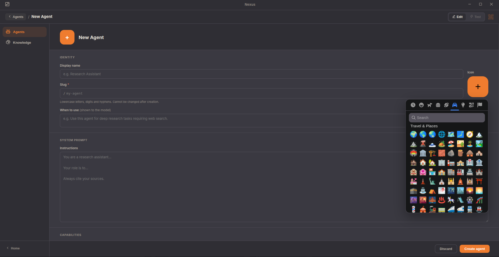
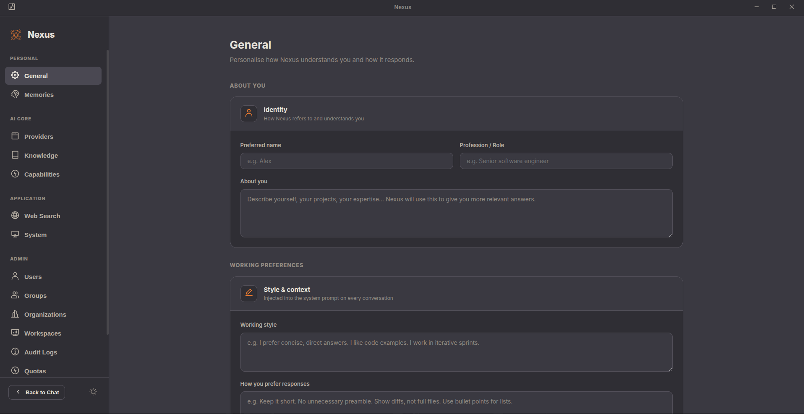

<p align="center">
  
</p>

<h1 align="center">Nexus AI</h1>

<p align="center">
  <b>Self-hosted AI platform for teams — desktop app, REST API, multi-user auth, and full agent governance.</b><br>
  <i>Built on nexus-engine &nbsp;·&nbsp; SQLite or PostgreSQL &nbsp;·&nbsp; 7 providers &nbsp;·&nbsp; AGPL-3.0</i>
</p>

<p align="center">
  
  
  
  
  
</p>

---

## 🤔 What is Nexus AI?

**[nexus-engine](https://github.com/EngineerProjects/nexus-engine)** is the open-source Go runtime for multi-turn AI agents (tools, permissions, sessions, RAG, MCP). **Nexus AI** is the production layer on top: a multi-user backend with a full REST API and a desktop application.

```
┌─────────────────────────────────┐
│  nexus-ui  (Electron + React)   │  Desktop app
└────────────┬────────────────────┘
             │ HTTP + SSE
┌────────────▼────────────────────┐
│  cmd/api  →  internal/api       │  REST API (auth, sessions, SSE streaming)
│  internal/<domain>/             │  Auth · Memory · Plans · Skills · RAG
│  internal/db/                   │  SQLite / PostgreSQL via GORM
└────────────┬────────────────────┘
             │ Go SDK (pkg/sdk)
┌────────────▼────────────────────┐
│  nexus-engine  (submodule)      │  Agent runtime, tools, providers, MCP
└─────────────────────────────────┘
```

Dependency direction is strictly one-way: `nexus-ai` imports `nexus-engine/pkg/*` only, never the reverse.

---

## 🖥️ Desktop UI

Nexus AI ships with `nexus-ui`, an Electron + React desktop application that wraps the full HTTP API.

<table>
  <tr>
    <td align="center" width="50%">
      
      <br><sub><b>Home</b> — new chat, quick actions, provider &amp; model selector</sub>
    </td>
    <td align="center" width="50%">
      
      <br><sub><b>Workspace · Agents</b> — create custom agents with emoji icon, system prompt, and capabilities</sub>
    </td>
  </tr>
  <tr>
    <td align="center" width="50%">
      
      <br><sub><b>Settings</b> — personal preferences, providers, knowledge, admin panel</sub>
    </td>
    <td align="center" width="50%">
      
      <br><sub><b>Skills Creator</b> — author reusable agent skills with live preview and test chat</sub>
    </td>
  </tr>
</table>

---

## ✨ Features

- 🔐 **Multi-user auth** - email/password, API keys, roles, organizations, workspaces
- 📡 **Streaming chat** - SSE-based streaming with per-turn tool events and permission prompts
- 💬 **Session management** - persistent sessions with ownership and workspace isolation
- 🧠 **Memory** - user-defined memories injected into every session context
- 📋 **Plans** - structured multi-step plans attached to sessions with status lifecycle
- ⚡ **Skills** - slash-command shortcuts that resolve to prompt expansions, skill repository browser
- 📚 **Knowledge / RAG** - hybrid BM25 + vector search over document corpora, multi-backend
- 🔌 **MCP servers** - per-user MCP server config stored in DB, resolved at runtime, hot-reload
- ⏰ **Scheduled tasks** - cron-based background agent runs with job history
- 🌐 **Web search** - pluggable backends (Tavily, Exa, Jina, SearXNG, auto-select)
- 📎 **File attachments** - images and documents injected as context
- 📊 **Audit log** - append-only log of all queries and admin actions
- 📈 **Quotas** - per-user usage counters (daily / monthly)
- 🤖 **Anthropic compat** - drop-in `/v1/messages` endpoint for any Anthropic SDK client
- 📉 **Observability** - Prometheus `/metrics`, structured log output
- 🌍 **Multi-provider** - Anthropic, OpenAI, Mistral, Google, xAI, OpenRouter, Ollama

---

## 📊 How Nexus AI Compares

| Feature | **Nexus AI** | Claude Code | Open WebUI | LibreChat | AnythingLLM |
|---|:---:|:---:|:---:|:---:|:---:|
| Multi-user + RBAC | ✅ | ❌ | ✅ | ✅ | ✅ |
| Self-hosted | ✅ | ✅ | ✅ | ✅ | ✅ |
| Multi-provider | ✅ | ❌ | ✅ | ✅ | ✅ |
| Real agent execution | ✅ | ✅ | ❌ | ❌ | Partial |
| Sandboxed bash / tools | ✅ | ✅ | ❌ | ❌ | ❌ |
| MCP client | ✅ | ✅ | Partial | ❌ | ❌ |
| Skills system | ✅ | ✅ | ❌ | ❌ | ❌ |
| Knowledge base / RAG | ✅ | ❌ | ✅ | ✅ | ✅ |
| Scheduled tasks | ✅ | ❌ | ❌ | ❌ | ❌ |
| Desktop app | ✅ | ❌ | ❌ | ❌ | ✅ |
| REST API + SSE | ✅ | ❌ | ✅ | ✅ | Partial |
| Go binary (no deps) | ✅ | ❌ | ❌ | ❌ | ❌ |
| Audit log | ✅ | ❌ | ❌ | Partial | ❌ |
| Agent team runtime | 🔜 | ❌ | ❌ | ❌ | ❌ |
| Open-source license | AGPL-3.0 | ❌ | MIT | MIT | MIT |

---

## 🗂️ Repository Structure

```
nexus-ai/
├── cmd/api/              ← thin entrypoint (main.go + config.go)
├── internal/
│   ├── api/              ← HTTP handlers, SSE, routes
│   ├── app.go            ← App container, Dependencies, NewApp
│   ├── agents/           ← DB-stored agent definitions
│   ├── audit/            ← audit log service
│   ├── auth/             ← Identity, sessions, API keys, RBAC
│   ├── bkerr/            ← typed error kinds (not-found, forbidden, etc.)
│   ├── db/               ← GORM stores, migrations (SQLite + PostgreSQL)
│   ├── files/            ← file upload/download, workspace management
│   ├── knowledge/        ← RAG ingestion and search
│   ├── mcp/              ← MCP server config store
│   ├── memories/         ← user memory CRUD + context injection
│   ├── metrics/          ← Prometheus snapshot service
│   ├── plans/            ← plan management
│   ├── preferences/      ← per-user preferences and permission modes
│   ├── prompt/           ← system prompt assembly layer
│   ├── query/            ← query orchestration (provider, memory, RAG, skills)
│   ├── quotas/           ← usage counters (daily/monthly)
│   ├── resources/        ← organizations, workspaces, user admin
│   ├── scheduler/        ← cron job engine
│   ├── settings/         ← provider credentials + OAuth
│   ├── skills/           ← skill registry + prompt resolution
│   └── websearch/        ← web search abstraction
├── nexus-engine/         ← submodule: github.com/EngineerProjects/nexus-engine
├── nexus-skills/         ← submodule: github.com/EngineerProjects/nexus-skills
├── nexus-ui/             ← Electron desktop app (React + TypeScript)
└── docs/                 ← Architecture, development guide, UI docs
```

---

## 🚀 Quick Start

### Prerequisites

- Go 1.26+
- Node 22+ (for the desktop UI)
- Git with submodule support

### Clone

```bash
git clone --recurse-submodules https://github.com/EngineerProjects/nexus-ai.git
cd nexus-ai
```

### Configure

```bash
cp .env.example .env
# Edit .env: set NEXUS_ADMIN_EMAIL, NEXUS_ADMIN_PASSWORD,
# and at least one provider key (ANTHROPIC_API_KEY, OPENAI_API_KEY, etc.)
```

### Run the backend

```bash
go run ./cmd/api
# API available at http://localhost:8090
```

### Run the desktop UI

```bash
make ui-install     # install npm deps
make ui-dev         # Electron in dev mode
```

Or start everything at once:

```bash
make dev
```

### Install git hooks (recommended)

```bash
make hooks
```

---

## ⚙️ Configuration

All config is via environment variables. See [`.env.example`](.env.example) for the full reference.

| Variable | Default | Description |
|---|---|---|
| `PORT` | `8090` | HTTP listen port |
| `LOG_LEVEL` | `INFO` | `DEBUG` · `INFO` · `WARN` · `ERROR` |
| `NEXUS_DB_DRIVER` | `sqlite` | `sqlite` or `postgres` |
| `NEXUS_DB_DSN` | `nexus.db` | Database connection string |
| `NEXUS_ADMIN_EMAIL` | - | Bootstrap admin email (first run) |
| `NEXUS_ADMIN_PASSWORD` | - | Bootstrap admin password (first run) |
| `NEXUS_ENABLE_SIGNUP` | `true` | Allow user self-registration |
| `ANTHROPIC_API_KEY` | - | Anthropic provider |
| `OPENAI_API_KEY` | - | OpenAI provider |
| `MISTRAL_API_KEY` | - | Mistral provider |
| `WEB_SEARCH_PROVIDER` | `auto` | `tavily` · `exa` · `jina` · `searxng` · `auto` |
| `RAG_EMBEDDING_PROVIDER` | `ollama` | `ollama` or `openai` |
| `RAG_EMBEDDING_MODEL` | `nomic-embed-text` | Embedding model name |

---

## 🌐 API

The server starts on port `8090` by default. All `/api/v1/*` routes require `Authorization: Bearer <token>` unless noted.

### Auth

```
POST   /api/v1/auth/login
POST   /api/v1/auth/register
POST   /api/v1/auth/logout
GET    /api/v1/auth/me
GET    /api/v1/auth/admin/ping       (admin only)
```

### Query

```
POST   /api/v1/query                 run a prompt (blocking JSON)
POST   /api/v1/query/stream          run a prompt (SSE streaming)
GET    /api/v1/permissions/:id       respond to a tool-permission request
GET    /api/v1/prompts/:id           respond to an interactive prompt request
```

### Sessions

```
GET    /api/v1/sessions
POST   /api/v1/sessions
GET    /api/v1/sessions/search
GET    /api/v1/sessions/:id
PATCH  /api/v1/sessions/:id
DELETE /api/v1/sessions/:id
```

### Agents

```
GET    /api/v1/agents
POST   /api/v1/agents
GET    /api/v1/agents/:slug
PUT    /api/v1/agents/:slug
DELETE /api/v1/agents/:slug
```

### Skills

```
GET    /api/v1/skills
POST   /api/v1/skills
PUT    /api/v1/skills/:name
DELETE /api/v1/skills/:name
GET    /api/v1/skills/:name/content
GET    /api/v1/skills/:name/tree
GET    /api/v1/skills/:name/file

GET    /api/v1/skills/repos          (admin only)
POST   /api/v1/skills/repos          (admin only)
DELETE /api/v1/skills/repos/:name    (admin only)
```

### Files

```
GET    /api/v1/files
POST   /api/v1/files
GET    /api/v1/files/:id/content
DELETE /api/v1/files/:id
```

### Knowledge (RAG)

```
GET    /api/v1/corpora
POST   /api/v1/corpora
GET    /api/v1/corpora/:id
DELETE /api/v1/corpora/:id
POST   /api/v1/corpora/:id/ingest
POST   /api/v1/corpora/:id/search
```

### Memories

```
GET    /api/v1/memories
POST   /api/v1/memories
DELETE /api/v1/memories
PUT    /api/v1/memories/:id
DELETE /api/v1/memories/:id
```

### Plans

```
GET    /api/v1/plans
GET    /api/v1/plans/:id
PATCH  /api/v1/plans/:id
```

### Scheduler

```
GET    /api/v1/scheduler/jobs
POST   /api/v1/scheduler/jobs
GET    /api/v1/scheduler/jobs/:id
PUT    /api/v1/scheduler/jobs/:id
DELETE /api/v1/scheduler/jobs/:id
POST   /api/v1/scheduler/jobs/:id/run
```

### MCP (admin only)

```
GET    /api/v1/mcp
GET    /api/v1/mcp/config
POST   /api/v1/mcp/config
GET    /api/v1/mcp/config/:id
PUT    /api/v1/mcp/config/:id
DELETE /api/v1/mcp/config/:id
POST   /api/v1/mcp/reload
```

### Settings (admin only)

```
GET    /api/v1/settings/providers
POST   /api/v1/settings/providers
PUT    /api/v1/settings/providers/:id
DELETE /api/v1/settings/providers/:id

GET    /api/v1/settings/embedder
PUT    /api/v1/settings/embedder

GET    /api/v1/settings/storage
PUT    /api/v1/settings/storage
```

### Web Search

```
POST   /api/v1/web/search
GET    /api/v1/web/search/settings
PUT    /api/v1/web/search/settings
GET    /api/v1/web/search/logs
GET    /api/v1/web/search/providers
POST   /api/v1/web/search/providers
GET    /api/v1/web/search/providers/:name
PUT    /api/v1/web/search/providers/:name
DELETE /api/v1/web/search/providers/:name
GET    /api/v1/web/search/domain-catalog
```

### Users

```
GET    /api/v1/users                 (admin)
POST   /api/v1/users                 (admin)
GET    /api/v1/users/me
GET    /api/v1/users/me/preferences
PUT    /api/v1/users/me/preferences
GET    /api/v1/users/me/api-keys
POST   /api/v1/users/me/api-keys
DELETE /api/v1/users/me/api-keys/:id
GET    /api/v1/users/:id
PATCH  /api/v1/users/:id
DELETE /api/v1/users/:id
```

### Groups, Organizations, Workspaces

```
GET|POST              /api/v1/groups
GET|PATCH|DELETE      /api/v1/groups/:id

GET|POST              /api/v1/organizations
GET|PATCH|DELETE      /api/v1/organizations/:id

GET|POST              /api/v1/workspaces
GET|PATCH|DELETE      /api/v1/workspaces/:id
```

### System

```
GET    /api/v1/models                list available models per provider
GET    /api/v1/quotas                usage counters for the current user
GET    /api/v1/audit/logs
POST   /api/v1/desktop/handshake     Electron desktop auth handshake
GET    /health
GET    /metrics                      Prometheus scrape endpoint
```

### Anthropic-compatible endpoint

```
POST   /v1/messages
```

Set `ANTHROPIC_BASE_URL=http://<host>/v1` in any Anthropic SDK client to route through Nexus.
Auth: `x-api-key: <nexus-api-key>` or `Authorization: Bearer <nexus-jwt>`.

---

## 🛠️ Development

```bash
make test           # go test ./...
make test-race      # go test -race ./...
make vet            # go vet ./...
make lint           # golangci-lint
make fmt            # gofmt -w .
make tidy           # go mod tidy
```

Full development guide: [`docs/development.md`](docs/development.md)  
Architecture overview: [`docs/architecture.md`](docs/architecture.md)

---

## 🧩 Adding a New Domain

**1. Service** - `internal/<domain>/service.go`

```go
package <domain>

type Service struct{ store *db.XxxStore }

func NewService(store *db.XxxStore) *Service { ... }
func (s *Service) List(ctx context.Context, p auth.Principal) ([]Thing, error) { ... }
```

**2. Wire** - `internal/app.go`

```go
// Dependencies
XxxStore *db.XxxStore

// App
Xxx *<domain>.Service

// NewApp
Xxx: <domain>.NewService(deps.XxxStore),
```

**3. Handler** - `internal/api/<domain>.go`

```go
func (app *App) handleThings(w http.ResponseWriter, r *http.Request) {
    principal, _ := authPrincipalFromContext(r.Context())
    things, err := app.backend.Xxx.List(r.Context(), principal)
    writeJSON(w, http.StatusOK, things)
}
```

**4. Route** - `internal/api/routes.go`

```go
apiV1.Handle("/things", app.authMiddleware(http.HandlerFunc(app.handleThings)))
```

---

## 🤝 Contributing

See [`CONTRIBUTING.md`](CONTRIBUTING.md). PRs target `dev`, never directly `main`.

---

## 📄 License

Nexus AI is licensed under the **GNU Affero General Public License v3.0** (AGPL-3.0).

The underlying runtime, [nexus-engine](https://github.com/EngineerProjects/nexus-engine), is Apache 2.0.

See [`LICENSE`](LICENSE) for the full text.
