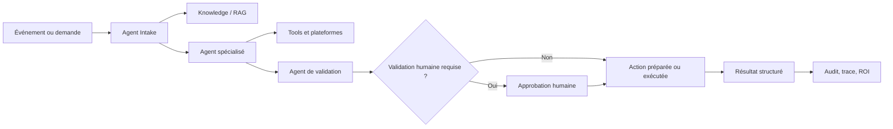

# Agent Workflows

## Intention

Agent Workflows est le premier produit Seshat à cadrer explicitement autour de l'exécution agentique.

L'objectif n'est pas de construire un clone généraliste de n8n. L'objectif est de permettre à une organisation de concevoir, gouverner et exécuter des processus métier sous forme d'équipes d'agents spécialisés, connectés à des outils, des plateformes, des sources de connaissance et des points de validation humaine.

Le canevas visuel reste important, mais il n'est pas le produit en lui-même. Le produit est la capacité à transformer un objectif métier en exécution fiable, observable et mesurable.

> n8n connecte des applications par des workflows. Seshat orchestre des agents gouvernés qui utilisent des outils, de la connaissance et des plateformes pour produire un résultat métier auditable.

## Objectif du produit

Agent Workflows permet de créer des processus métier visuels où chaque étape peut être portée par un agent, un outil, une plateforme, une source de connaissance, une condition, une validation humaine ou un contrat de sortie.

Le produit doit aider une entreprise à passer de :

- tâches manuelles répétées ;
- informations dispersées entre documents, emails, ERP, CRM, bases de données et messageries ;
- automatisations fragiles codées au cas par cas ;
- difficultés à prouver le gain de temps, la qualité ou le retour sur investissement ;

à :

- des agents spécialisés avec un rôle clair ;
- des outils et plateformes connectés sous gouvernance ;
- une mémoire et un contexte réutilisables ;
- des workflows auditables et testables ;
- des résultats structurés ;
- des gains mesurables en temps, erreurs évitées, ETP économisés et ROI.

## Positionnement

Agent Workflows est une couche "Knowledge-to-Action".

Elle part de la connaissance disponible dans l'entreprise, la confie à des agents capables de raisonner et d'agir, puis transforme ce raisonnement en exécution contrôlée.

Le produit se place entre trois mondes :

- **assistant IA** : conversation, compréhension d'intention, raisonnement ;
- **workflow automation** : triggers, conditions, actions, reprises, logs ;
- **gouvernance entreprise** : permissions, audit, approbation, isolation, contrôle des outils.

Seshat doit rester distinct des workflow builders horizontaux. Un utilisateur ne devrait pas avoir l'impression de câbler des API pour le plaisir de câbler des API. Il devrait avoir l'impression de construire une équipe opérationnelle : qui reçoit le travail, qui analyse, qui vérifie, qui agit, qui approuve, qui mesure.

## Utilisateur cible

Le produit s'adresse d'abord aux profils qui veulent automatiser un processus métier sans transformer chaque automatisation en projet logiciel :

- dirigeants de PME qui veulent réduire le travail administratif répétitif ;
- responsables opérations, finance, support, commercial ou back-office ;
- équipes qui ont déjà des outils mais manquent d'orchestration intelligente ;
- consultants ou intégrateurs qui veulent livrer des processus IA gouvernés ;
- organisations sensibles à la confidentialité, à l'audit et au self-hosted/local-first.

## Problème principal

Les entreprises ne manquent pas seulement d'automatisation. Elles manquent d'automatisation qui comprend le contexte.

Un workflow classique exécute des étapes déterminées. C'est puissant quand le processus est parfaitement stable, mais insuffisant quand il faut lire un document, comprendre une demande, vérifier une exception, appliquer une politique interne, demander une validation, ou choisir le bon outil selon le cas.

Les agents seuls ne suffisent pas non plus : sans structure, ils deviennent difficiles à gouverner, tester, auditer et mesurer.

Agent Workflows combine les deux :

- la structure du workflow ;
- la souplesse du raisonnement agentique ;
- la gouvernance d'une plateforme d'entreprise.

## Primitives du produit

### Agents

Un agent porte un rôle, une mission, un prompt système, un modèle, des outils autorisés, des outils interdits, des serveurs MCP, un mode de permission, une isolation et des limites d'exécution.

Dans le produit, l'agent doit devenir le premier citoyen du workflow. On ne crée pas seulement des nodes ; on compose des responsabilités.

Exemples :

- Agent Intake : reçoit et qualifie une demande.
- Agent Extraction : lit un document et structure les informations.
- Agent Validation : détecte incohérences, doublons, fraudes ou écarts.
- Agent ERP : prépare une action dans un système externe.
- Agent Communication : rédige une réponse ou notifie une personne.
- Agent Verifier : relit le résultat avant validation.

### Tools et plateformes

Les tools sont les capacités que les agents utilisent : rechercher dans la connaissance, lire un document, appeler une API, interroger une base, créer un ticket, envoyer un email, écrire dans un ERP, consulter un CRM.

Les plateformes connectées ne doivent pas devenir le centre du produit. Elles sont les mains des agents.

### Knowledge

Chaque workflow peut s'appuyer sur la mémoire de l'entreprise : politiques, procédures, historiques, documents, données clients, contraintes internes.

La connaissance donne aux agents le contexte que les automatisations classiques n'ont pas.

### Validation humaine

Certains processus peuvent être entièrement automatiques. D'autres doivent inclure une validation humaine, surtout quand il y a impact financier, juridique, client ou opérationnel.

Le produit doit donc traiter l'humain comme une étape normale du workflow, pas comme une exception.

### Contrat de sortie

Chaque workflow doit pouvoir définir le format attendu du résultat : JSON structuré, brouillon de réponse, rapport, décision, action préparée, score de confiance, liste d'anomalies, trace d'audit.

Ce contrat rend le workflow exploitable par un système externe et mesurable par l'entreprise.

## Schéma conceptuel

Ce schéma est volontairement conceptuel. Les illustrations finales devront montrer de vrais cas métier, pas des abstractions génériques.

## Cas d'usage prioritaires

### 1. Traitement de factures

Une facture arrive par email ou dépôt documentaire. Un agent la qualifie, un agent extrait les champs importants, un agent vérifie les incohérences, un agent prépare l'écriture dans l'ERP, puis un humain valide les cas sensibles.

Objectif métier :

- réduire la saisie manuelle ;
- accélérer le cycle facture-vers-écriture ;
- diminuer les erreurs ;
- mesurer les heures économisées et l'impact ETP.

### 2. Inbox opérationnelle

Les messages entrants deviennent des événements métier. L'agent trie, priorise, détecte les demandes actionnables, prépare les réponses, crée des tâches, escalade les cas importants ou transmet vers un autre workflow.

Objectif métier :

- réduire le temps perdu dans les emails et messageries ;
- éviter les demandes oubliées ;
- accélérer les réponses ;
- transformer la communication en action.

### 3. Contrôle documentaire

Un document est lu, comparé à des règles internes, enrichi par la connaissance existante, puis envoyé vers validation ou action.

Objectif métier :

- automatiser la lecture répétée ;
- détecter les écarts ;
- produire une synthèse fiable ;
- garder une trace explicable.

### 4. Reporting récurrent

Un workflow planifié récupère les données nécessaires, interroge la connaissance, génère un rapport, signale les anomalies et l'envoie à la bonne personne.

Objectif métier :

- fiabiliser les routines ;
- éviter les oublis ;
- standardiser les rapports ;
- mesurer le temps gagné.

## Ce que le produit n'est pas

Agent Workflows n'est pas :

- un clone de n8n ;
- un catalogue infini de connecteurs ;
- un outil de câblage API pour utilisateurs techniques seulement ;
- un moteur où chaque client doit tout inventer depuis une page blanche ;
- une promesse d'autonomie totale sans gouvernance.

Seshat peut reprendre certaines bonnes idées de n8n : triggers comme nodes, webhooks, expressions, pinned data, replay visuel, validation, traces. Mais ces primitives doivent toujours être filtrées par la question : est-ce que cela rend les agents métier plus fiables, plus gouvernables ou plus mesurables ?

## MVP du produit

Le MVP d'Agent Workflows doit rester centré sur quelques workflows métier concrets plutôt que sur une plateforme générique infinie.

Priorité de construction :

1. Consolider le socle Automation/dataflow existant : triggers, webhooks, exécutions, traces, validation, expressions, pinned data, replay.
2. Recentrer l'UX autour des agents : création d'agent, rôle, tools, plateformes, connaissance, contrat de sortie.
3. Livrer un premier workflow métier démontrable, probablement Inbox Agent ou traitement de factures selon la demande client la plus immédiate.
4. Ajouter les mesures de valeur : temps économisé, volume traité, taux d'erreur, validations humaines, ETP estimé, ROI.

## Mesures de succès

Un workflow réussi doit pouvoir répondre à quatre questions :

- Quel travail humain répétitif a été réduit ?
- Combien de temps ou d'ETP cela économise-t-il ?
- Quel risque a été réduit : erreur, oubli, retard, non-conformité ?
- Quelle preuve garde-t-on : trace, décision, données d'entrée, résultat, validation ?

Ces mesures doivent devenir centrales dans le positionnement commercial. L'automatisation n'est pas vendue comme une prouesse technique ; elle est vendue comme un gain opérationnel prouvable.

## Illustrations à produire

Les illustrations devront être concrètes et proches du travail réel :

- capture ou mockup du canevas avec des agents nommés par rôle ;
- schéma "facture reçue -> extraction -> validation -> ERP -> approbation" ;
- schéma "message entrant -> tri -> réponse -> escalade -> action" ;
- vue de run avec trace par agent, données d'entrée, sortie, validation et ROI estimé ;
- avant/après montrant le temps humain réduit sur un processus.

Éviter les illustrations abstraites trop marketing. Le produit doit sembler opérationnel, pas décoratif.

## Phrase courte

Agent Workflows permet aux entreprises de transformer leurs processus répétitifs en équipes d'agents gouvernés, connectés à leurs outils et à leur connaissance, avec des résultats auditables et un ROI mesurable.

